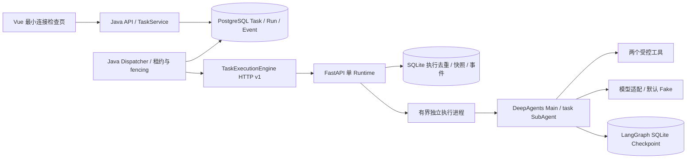

# P0 实际架构

Java 分为 api/application/domain/infrastructure。Controller 处理 DTO 与投影，Service 处理幂等载荷哈希，Repository 负责状态转换事务与数据库锁，Dispatcher 只做有限轮询/失联检测，HttpTaskExecutionEngine 位于扩展接口后。

API 新任务为 QUEUED，原子领取后 CLAIMED；收到 Runtime RUNNING 才进入 RUNNING。Run 的 CREATED/CLAIMED/ACCEPTED/RUNNING 与 Task 状态分开保存；Checkpoint ID 仅在最终图快照可读后写入 Run。所有状态更新带版本，敏感的领取/终态更新由行锁串行化；fence 校验绑定持有者与有效租约。数据库不可用时 API 返回 503，调度器下轮尝试；不在事务中做 HTTP/模型调用。

Runtime 提交先持久化并去重，随后启动进程；工具/子 Agent 事件追加持久化。执行进程退出由监控线程识别，服务进程退出由 Java 租约识别。取消标记可以早于提交持久化，避免迟到提交启动已取消任务。终态事件和 Runtime 最终快照原子写入；Java 拉取事件后按运行内序号去重并分配业务序号。

映射关系：Task UUID 表示业务任务；P0 revision 固定 1；execution_id UUID 表示唯一执行尝试/AgentRun；`checkpoint_thread_id = task_id + '-' + execution_id`；LangGraph state 是内部消息与工具状态；Checkpoint ID 是该 thread 的版本化状态点，一个 thread 有多个 Checkpoint。业务 Task 不把 Checkpoint 当作完成标志。请求还有稳定 request_id、trace_id，事件带 task/execution/trace/sequence/time。

工具使用 Pydantic 输入/输出 Schema；有限上下文工具只返回任务/运行 ID 和用途，统计工具只计算最多 100 个有限数值。真实 Provider 经 ToolStrategy(AgentResult) 返回结构化响应，Fake 保留确定性 JSON；模型输出均经 AgentResult 校验，不能作为权限结论。SubAgent 不自动获得主工具集合，不继承主消息，委派描述由数值投影重建。P0 不访问真实文件或数据源，没有完整租户权限系统。

事件 API 是轮询，不提供 SSE。MinIO 仅可选环境预留，未接入 Artifact；Redis、Temporal、SQL/RAG/RBAC/SkillHub 未实现。
