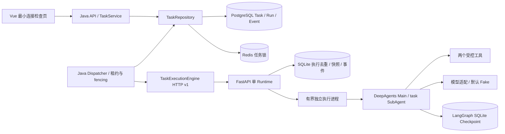

# P0 实际架构

Java 分为 api/application/domain/infrastructure。Controller 处理 DTO 与投影，Service 计算幂等载荷哈希，Repository 管理状态转换事务、任务锁与版本检查，MyBatis-Plus Mapper 执行 SQL 和实体映射。Dispatcher 在租约约束下轮询 Runtime，由 `HttpTaskExecutionEngine` 实现 `TaskExecutionEngine` 契约。

API 创建的任务为 QUEUED，领取后进入 CLAIMED。Runtime 报告 RUNNING 时，Java 可更新任务为 RUNNING。Run 单独保存 CREATED、CLAIMED、ACCEPTED 等执行状态，成功时可关联 Runtime 已读取的 Checkpoint ID。数据库访问失败时，业务 API 返回 503，调度器在下一轮重试。

Runtime 提交先持久化并去重，随后启动进程；工具/子 Agent 事件追加持久化。执行进程退出由监控线程识别，服务进程退出由 Java 租约识别。取消标记可以早于提交持久化，避免迟到提交启动已取消任务。终态事件和 Runtime 最终快照原子写入；Java 拉取事件后按运行内序号去重并分配业务序号。

映射关系：Task UUID 表示业务任务；P0 revision 固定 1；execution_id UUID 表示唯一执行尝试/AgentRun；`checkpoint_thread_id = task_id + '-' + execution_id`；LangGraph state 是内部消息与工具状态；Checkpoint ID 是该 thread 的版本化状态点，一个 thread 有多个 Checkpoint。业务 Task 不把 Checkpoint 当作完成标志。请求还有稳定 request_id、trace_id，事件带 task/execution/trace/sequence/time。

工具使用 Pydantic 输入/输出 Schema；有限上下文工具只返回任务/运行 ID 和用途，统计工具只计算最多 100 个有限数值。真实 Provider 经 ToolStrategy(AgentResult) 返回结构化响应，Fake 保留确定性 JSON；模型输出均经 AgentResult 校验，不能作为权限结论。SubAgent 不自动获得主工具集合，不继承主消息，委派描述由数值投影重建。P0 不访问真实文件或数据源，没有完整租户权限系统。

事件 API 使用排他游标轮询。已实现范围及后续能力见 [P0 已知限制](known-limitations.md)。

## Java 持久化实现

- 使用 MyBatis-Plus 3.5.17 Spring Boot 3 Starter，持久化实体与 API DTO/业务快照分离。
- TaskMapper/RunMapper 继承 BaseMapper，EventMapper 处理复合主键事件；并发敏感 SQL 在 XML，JSONB 由显式 TypeHandler 映射。
- Repository 使用 TransactionTemplate 执行状态机更新。Flyway 管理 PostgreSQL 表结构，当前迁移为 V1。持久化选型和验证见 [ADR-0002](../adr/0002-mybatis-plus-persistence.md)。

## 分布式锁与乐观并发

`DistributedLock` 封装 Redisson。Java 从排队候选中选出任务，按 task_id 获取锁，读取当前状态并在 PostgreSQL 事务内更新。取消、对账和租约过期使用同一个任务锁。锁在提交或回滚后释放，HTTP 和模型调用在事务外进行。

PostgreSQL 通过 task_id、state 和 version 执行 CAS，拒绝陈旧更新。同状态续租和事件导入也递增 version。Run 回写再验证租约 owner、fence 和有效期。首次创建依赖数据库唯一幂等键，并在同一事务写入 Task、Run 和首个事件。

Redis 为 Java 启动和任务协调的必需依赖。锁等待、watchdog、前缀及失败语义见 [ADR-0003](../adr/0003-redisson-task-locks.md)。

## 部署拓扑

开发时可以独立运行三端，PostgreSQL 和 Redis 由开发 Compose 或已有实例提供。应用 Compose 支持使用已有数据库服务的三容器模式，以及包含 PostgreSQL 和 Redis 的五容器模式。两个模式使用同一组前台、后台和 Runtime 镜像。

宿主机原生 Nginx 通过回环端口访问前后台。前台容器以 Docker DNS 解析后台，并在同源路径代理任务 API 和健康检查。后台容器内的 Nginx 将请求转发给容器内回环地址上的 Java，Java 通过 Docker DNS 调用单实例 Runtime。Runtime 的 SQLite 去重库和 Checkpoint 共用一个持久卷，五容器模式为 PostgreSQL 和 Redis 各提供一个独立卷。部署命令见 [README](../../README.md#使用-docker-compose-部署-p0)。
